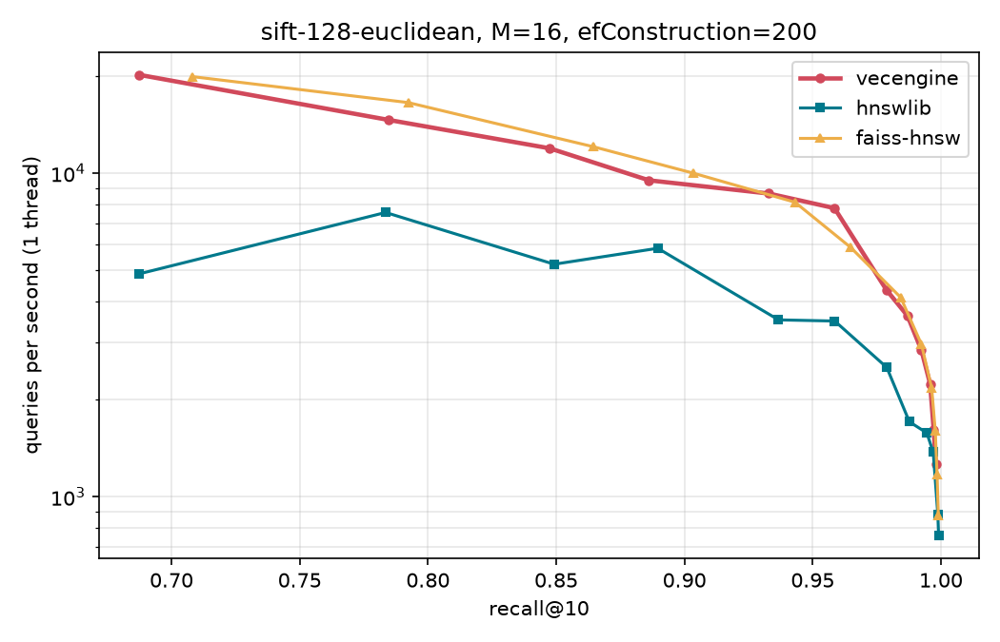
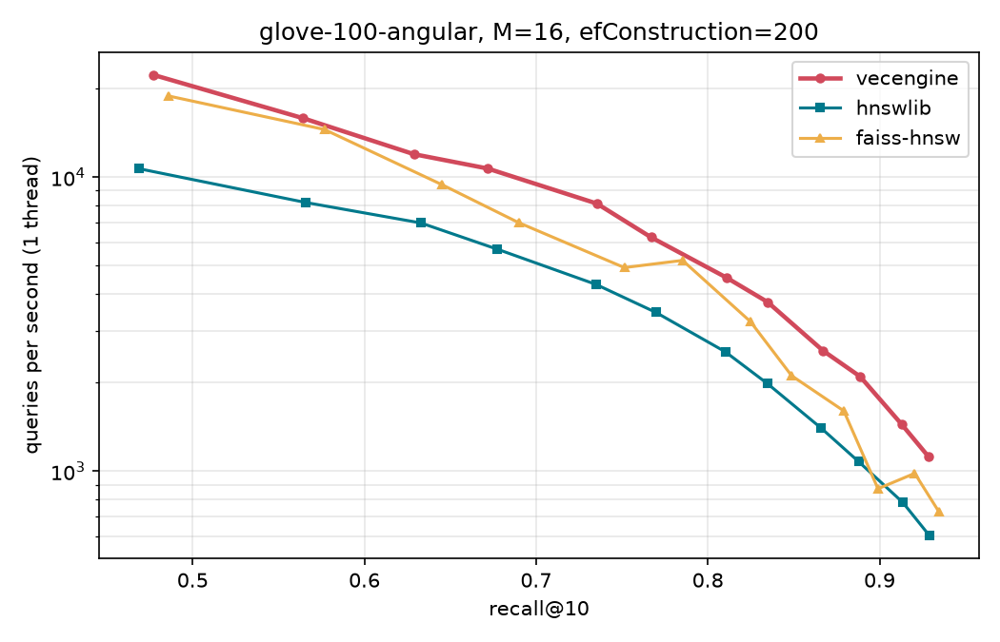

# vector-engine

A vector search engine written from scratch in Rust: HNSW graph index, quantization, filtered search and hybrid BM25 + vector ranking.

Work in progress. What works today: SIMD distance kernels, exact search, an HNSW index with a parallel build, and Python bindings. On the standard [ann-benchmarks](https://ann-benchmarks.com) datasets it runs level with FAISS's HNSW.



## Benchmarks

Apple M1 (8 GB), M=16, efConstruction=200 for every library. 1000 queries, one thread, one query per call from Python, best of 3 runs. Builds use all cores. Full sweeps in [`bench/results/`](bench/results/).

**SIFT-1M** (1M x 128, L2)

| | build | QPS @ recall ~0.96 | QPS @ recall ~0.99 |
|---|---|---|---|
| vecengine | **104s** | 7,794 (0.959) | 2,835 (0.992) |
| faiss-hnsw 1.10 | 154s | 5,895 (0.965) | 2,958 (0.992) |
| hnswlib 0.8 | 175s | 3,490 (0.959) | 1,574 (0.995) |

**GloVe-100** (1.18M x 100, cosine)

| | build | QPS @ recall ~0.89 | QPS @ recall ~0.93 |
|---|---|---|---|
| vecengine | **136s** | 2,098 (0.889) | 1,119 (0.929) |
| faiss-hnsw 1.10 | 263s | 871 (0.899) | 730 (0.934) |
| hnswlib 0.8 | 313s | 1,078 (0.888) | 604 (0.929) |

hnswlib's distance kernels are SSE/AVX only, so on ARM it falls back to scalar loops. Expect the gap to it to be much smaller on x86.



## Python

```python
import numpy as np
import vecengine

index = vecengine.Index(128, metric="l2", m=16, ef_construction=200)  # or "cosine", "ip"
index.add(np.random.rand(100_000, 128).astype(np.float32))

ids, distances = index.search(query, k=10, ef=64)     # query: (128,) -> (10,)
ids, distances = index.search(queries, k=10, ef=64)   # queries: (n, 128) -> (n, 10), parallel
```

Build it with `pip install ./crates/py` (needs Rust).

## Running it

```sh
cargo test --release

# datasets (~1 GB) into data/
python3 -m venv .venv && .venv/bin/pip install -r bench/requirements.txt
.venv/bin/python bench/download.py

# Rust-only eval: build, then sweep ef
cargo run --release --example eval -- data/sift-128-euclidean
cargo run --release --example eval -- data/sift-128-euclidean --n 100000 --ef 20,40,80
cargo run --release --example eval -- data/glove-100-angular --index flat

# comparison against hnswlib and faiss
.venv/bin/pip install ./crates/py
.venv/bin/python bench/run.py sift-128-euclidean
.venv/bin/python bench/plot.py sift-128-euclidean

# distance kernel micro-benchmarks
cargo bench --bench distance
```

## How it works

**Distances.** L2, inner product and cosine (normalised at insert, then dot product), all expressed as "smaller is closer". NEON and AVX2+FMA kernels with four independent accumulators, 4.5-14x faster than the plain Rust loop:

| dim | SIMD | scalar | speedup |
|---|---|---|---|
| 128 | 11.2 ns | 63.7 ns | 5.7x |
| 768 | 51.9 ns | 621.7 ns | 12.0x |
| 1536 | 113.3 ns | 1353.9 ns | 11.9x |

The compiler won't vectorise the scalar loop itself: float addition isn't associative, so it can't reorder the sum across lanes.

**HNSW.** Standard algorithm from the paper with the neighbour selection heuristic. Neighbour lists sit in flat fixed-stride arrays rather than per-node vectors. The visited set is a generation-stamped array, so resetting it between searches is O(1).

**Parallel build.** Nodes are allocated up front, then inserted with rayon. Each node has a 1-byte lock that is taken to read or change its neighbour list while building. Lists are stored as atomics, so searches (which can't overlap a build) read them without locking. Going from one thread to eight took the SIFT-1M build from 335s to 85s.

**Exact search.** Used for ground truth. Searching one query at a time is memory-bandwidth bound (8 threads ran no faster than one core's worth of compute), so batch search scores 32 queries against each cache-sized block of data. SIFT-1M: 92 to 154 QPS; GloVe: 80 to 241 QPS.

## Layout

```
crates/core/src/
  distance.rs   L2 / dot / cosine, scalar + NEON + AVX2
  neighbor.rs   result type and bounded top-k heap
  flat.rs       exact search
  hnsw.rs       HNSW graph index
  dataset.rs    benchmark dataset loading, recall@k
  io.rs         fvecs / ivecs readers
crates/core/examples/eval.rs   build + evaluate on a dataset
crates/py/                     Python bindings (pyo3 + maturin)
bench/                         dataset download, comparison runs, plots
```

## Roadmap

- [x] SIMD distances, exact search
- [x] HNSW
- [x] Python bindings, benchmarks against hnswlib and FAISS
- [x] Parallel build
- [ ] On-disk segments, WAL, mmap loading, deletes
- [ ] Quantization (SQ8, PQ, binary) with reranking
- [ ] Filtered search
- [ ] BM25 + hybrid search
- [ ] HTTP / gRPC server, Docker image

## License

MIT
