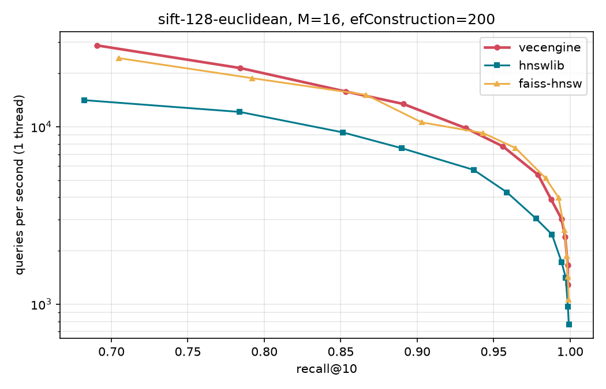

# vector-engine

A vector database written from scratch in Rust: HNSW index, durable storage with a write-ahead log, quantization, metadata filters, BM25 + vector hybrid search, and an HTTP server.



- **Search speed level with FAISS's HNSW** on SIFT-1M and GloVe-100, with the fastest parallel build of the three libraries tested.
- **Crash-safe storage**: WAL + immutable mmapped segments. A kill-and-recover test SIGKILLs a writer 1,000 times at random points and checks nothing acknowledged is lost.
- **Filtered search that doesn't collapse on selective filters**: 0.1%-selective filters run at 121k QPS instead of 29 for a plain filtered graph walk.
- **Hybrid search** beats both BM25 and vector search on BEIR SciFact (nDCG@10 0.683 vs 0.666 / 0.645).
- **Product quantization** cuts per-vector memory 16x for a 0.002 drop in recall.

## Quick start

```sh
docker build -t vecengine . && docker run -p 8080:8080 -v ve-data:/data vecengine
# or: cargo run --release -p vecengine-server -- --data ./collections
```

```sh
curl -X PUT localhost:8080/collections/docs -H 'content-type: application/json' \
  -d '{"dim": 3, "metric": "cosine", "text_field": "title"}'

curl -X PUT localhost:8080/collections/docs/points -H 'content-type: application/json' -d '{"points": [
  {"id": 1, "vector": [0.1, 0.9, 0.0], "payload": {"title": "rust vector search", "year": 2024}},
  {"id": 2, "vector": [0.8, 0.1, 0.1], "payload": {"title": "python notebooks", "year": 2020}}]}'

# vector, keyword (text), or both (hybrid); optional filter
curl -X POST localhost:8080/collections/docs/search -H 'content-type: application/json' \
  -d '{"vector": [0.2, 0.8, 0.0], "text": "rust", "k": 5,
       "filter": {"field": "year", "range": {"gte": 2022}}}'
```

| | |
|---|---|
| `PUT /collections/{name}` | create: `dim`, `metric` (`l2`, `ip`, `cosine`), optional `m`, `ef_construction`, `text_field` |
| `GET` / `DELETE /collections/{name}` | info, drop |
| `GET /collections` | list with stats |
| `PUT /collections/{name}/points` | upsert `{"points": [{"id", "vector", "payload"}]}` |
| `POST /collections/{name}/points/delete` | `{"ids": [...]}` |
| `GET /collections/{name}/points/{id}` | vector and payload |
| `POST /collections/{name}/search` | `vector` and/or `text`, `k`, `ef`, `filter`, `with_payload` |
| `POST /collections/{name}/flush`, `/compact` | write the memtable out; rebuild without deleted points |

Filters: `{"field": f, "eq": value}`, `{"field": f, "range": {"gt"/"gte"/"lt"/"lte": n}}`, `{"and": [...]}`, `{"or": [...]}`, `{"not": {...}}`.

The index is also usable from Python (`pip install ./crates/py`):

```python
import vecengine
index = vecengine.Index(128, metric="l2", m=16, ef_construction=200)
index.add(vectors)                          # float32 (n, 128)
ids, distances = index.search(query, k=10, ef=64)
```

## Benchmarks

Apple M1, 8 GB. Each run's command and full output are in [`bench/results/`](bench/results/).

**Against FAISS and hnswlib.** M=16, efConstruction=200 for all three; 1000 queries, one thread, one query per call from Python, best of 3. Builds use all cores.

| SIFT-1M | build | QPS (recall) at ef=64 | QPS (recall) at ef=192 |
|---|---|---|---|
| vecengine | **96s** | 7,756 (0.956) | 3,016 (0.994) |
| faiss-hnsw 1.10 | 109s | 7,586 (0.964) | 2,613 (0.996) |
| hnswlib 0.8 | 150s | 4,274 (0.959) | 1,724 (0.994) |

| GloVe-100 | build | QPS (recall) at ef=256 | QPS (recall) at ef=512 |
|---|---|---|---|
| vecengine | **147s** | 2,103 (0.888) | 1,110 (0.931) |
| faiss-hnsw 1.10 | 198s | 1,830 (0.902) | 892 (0.937) |
| hnswlib 0.8 | 313s | 1,082 (0.887) | 591 (0.929) |

At equal recall the vecengine and FAISS curves overlap (plots: [SIFT](bench/results/sift-128-euclidean.png), [GloVe](bench/results/glove-100-angular.png)). hnswlib only has SSE/AVX distance kernels, so on ARM it runs scalar loops; expect a smaller gap to it on x86.

**Quantization** (SIFT-1M, recall@10 at ef=160 after exact rerank): float32 0.991 at 512 B/vector, SQ8 0.991 at 128 B, PQ32 0.989 at 32 B, PQ16 0.976 at 16 B. Binary codes reach only 0.44 on SIFT; they suit high-dimensional neural embeddings, not 128-d integer histograms.

**Filtered search** (SIFT 200k): a filtered graph walk does 29 QPS when 0.1% of points match; scanning the matches exactly does 98k. The two cross at ~10%, where the default strategy switches. [Table](bench/results/filtered-sift-200k.md).

**Hybrid search** (BEIR SciFact, nDCG@10): BM25 0.666, vector (all-MiniLM-L6-v2) 0.645, hybrid with reciprocal rank fusion 0.683. The first two match the published BEIR baselines (0.665, 0.645). [Details](bench/results/hybrid-scifact.md).

**Server** (SIFT 200k over HTTP): ingest 10k vectors/s, recall@10 0.9975, 19.6k searches/s at 8 clients with p99 1.0 ms. [Load test](bench/results/server-sift-200k.md).

## How it works

[`docs/design.md`](docs/design.md) covers the details. In short:

- **Distances**: NEON / AVX2+FMA kernels with four accumulators, 4.5-14x faster than the scalar loop.
- **HNSW**: neighbour lists in flat fixed-stride arrays; parallel build with a lock per node; lock-free search over atomics. The design notes describe a race in the first parallel build that left 1.6% of nodes unreachable, and how it was found and fixed.
- **Storage**: writes go to a checksummed WAL and an in-memory HNSW, flushed as immutable segments that are mmapped on load. The manifest rename is the commit point; deletes are bitmaps until compaction.
- **Filters**: per-segment bitmap and sorted-range indexes over JSON payloads; per-segment choice between graph walk and exact scan.
- **Hybrid**: BM25 with document frequencies summed across segments, fused with vector results by reciprocal rank fusion.

## Testing

`cargo test --workspace` runs unit, property and API tests (SIMD kernels against scalar, WAL recovery at every byte offset, a parallel-build reachability check, filters, persistence, the HTTP API). `cargo run --release -p vecengine-storage --example crash_test -- 1000` is the kill-and-recover test. CI runs all of it on Linux and macOS, plus the Python bindings and a Docker smoke test.

## Running the benchmarks

```sh
python3 -m venv .venv && .venv/bin/pip install -r bench/requirements.txt
.venv/bin/python bench/download.py                     # SIFT-1M, GloVe-100 into data/
cargo run --release --example eval -- data/sift-128-euclidean --quant none,sq8,pq32
.venv/bin/pip install ./crates/py && .venv/bin/python bench/run.py sift-128-euclidean
cargo run --release -p vecengine-storage --example filter_bench -- data/sift-128-euclidean
.venv/bin/python bench/beir.py && cargo run --release -p vecengine-storage --example hybrid_eval -- data/scifact
cargo bench --bench distance
```

## Layout

```
crates/core      distances, exact search, HNSW (+ file format), quantization, BM25
crates/storage   collections: WAL, segments, deletes, compaction, filters, hybrid search
crates/server    HTTP API (axum)
crates/py        Python bindings (pyo3)
bench/           dataset scripts, comparison runs, results
docs/design.md   design notes
```

## Limitations

Single node, no replication. Quantization codes aren't persisted yet. Writes to a collection block its searches while they hold the lock. Full list in the [design notes](docs/design.md#known-limitations).

## License

MIT
