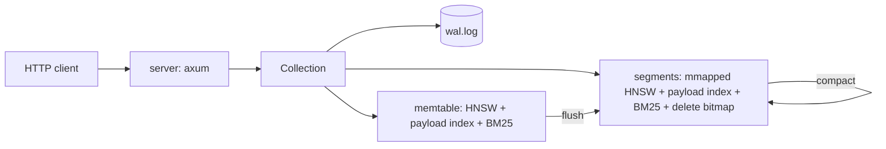

# Design notes

How the pieces fit together and why they are built the way they are. Numbers are from an Apple M1 with 8 GB unless stated; the runs behind them are in [`bench/results/`](../bench/results/).



## Distances

Every metric is turned into "smaller is closer": squared L2, negated dot product, and `1 - dot` for cosine with vectors normalised on insert. The index code never branches on the metric beyond one `match`.

The kernels use NEON on ARM and AVX2+FMA on x86 (picked at runtime), with four independent accumulators so consecutive FMAs don't wait on each other. They are 4.5x faster than the scalar loop at 96 dims and 12-14x at 768+. The compiler won't do this itself: float addition isn't associative, so reordering the sum across lanes changes the result and needs to be done by hand. Property tests compare the SIMD and scalar versions on random inputs, with a tolerance relative to `sum(|a_i * b_i|)`. A tolerance relative to the result fails when the terms cancel to ~0, which is how an early version of the test went flaky.

## HNSW

Standard algorithm (Malkov & Yashunin) with the neighbour selection heuristic: a candidate is kept only if it is closer to the new node than to every neighbour already kept. This spreads links across directions instead of spending them all on one tight cluster.

**Layout.** A node's links on a layer are a fixed-size slot `[count, id, id, ...]`. Layer 0 is one array with stride `2M + 1`; upper layers are one array plus per-node offsets. The whole graph is five flat arrays, so it can be written to a file and used in place through mmap. The visited set is a `u32` array stamped with a per-search generation number, so resetting it is a counter increment.

**Parallel build.** Nodes are allocated up front (levels are drawn sequentially from a seed), then inserted with rayon. Each node has a one-byte lock that is taken to read or change its neighbour list during a build. Lists are `AtomicU32`, so searches, which can't overlap a build (`&self` vs `&mut self`), read them without locks; relaxed atomic loads compile to plain loads. A node that becomes the new top level holds the entry-point lock for its whole insert.

The first version had a race. An insert could reach node X through X's upper-layer links and descend into a lower layer from X before X had written that layer's list. It saw an empty list, so it got poorly connected, and any link it added to X was overwritten when X wrote its own list a moment later. With 8 threads, 1.6% of nodes couldn't be found even by searching for their own vector. Recall averaged over many queries barely moved, which is why the benchmarks didn't catch it; the storage crash test, which checks that every stored vector is its own nearest neighbour, did. The fix, as in hnswlib, is for each insert to hold its node's lock for the whole insert. That can't deadlock, because the lock is taken before anything links to the node, so nobody can be waiting on it yet. 8 threads take the SIFT-1M build from 335s to ~85s.

## Quantization

Optional per index: SQ8 (a byte per dimension), PQ (k-means codebooks of 256 per sub-vector, distances via per-query lookup tables) or binary (sign against the per-dimension mean, Hamming distance). The graph walk uses approximate distances on the codes, then the final `ef` candidates are rescored with the full vectors.

On SIFT-1M, PQ with 32 sub-vectors (32 bytes/vector, 16x smaller) loses almost nothing after rerank: recall@10 0.989 vs 0.991 at ef=160. QPS doesn't improve here because the float kernel is already cheap at 128 dims. The gain is memory: the walk only touches codes, and with the index mmapped, full vectors are read only for the candidates being reranked. Binary codes reach only 0.44: 128 bits are too few for SIFT's integer histograms. They are meant for high-dimensional neural embeddings.

## Storage

A collection is a directory:

```
manifest.json   config + live segment ids
wal.log         writes since the last flush
seg-N.hnsw      graph + vectors (mmapped)
seg-N.meta      external ids + payloads
seg-N.del       deletion bitmap
```

**Writes** append one frame `[len][crc32][records...]` to the WAL (fsync optional), then go into the memtable, an in-memory HNSW. A batch shares one checksum, so after a crash it is replayed whole or not at all. Replay stops at the first short or corrupt frame and truncates there; this is tested by cutting the log at every byte offset.

**Flush** writes the memtable as a new segment, persists changed deletion bitmaps, replaces the manifest (temp file, fsync, rename, fsync directory), then empties the WAL. The manifest rename is the commit point. A crash before it leaves orphan segment files that recovery deletes; a crash after it, before the WAL is emptied, replays writes that already reached a segment, which is harmless because an upsert of the same value is idempotent.

**Deletes and overwrites** set a bit in the owning segment's bitmap. Deleted nodes stay in the graph, because they still carry paths between live ones; search walks through them but never returns them. Compaction rebuilds all live points into one segment.

**Testing.** `examples/crash_test.rs` runs a child process through a deterministic stream of upserts, deletes, batches, flushes and compactions, SIGKILLs it at a random moment, reopens the collection and checks it holds exactly the acknowledged operations, plus possibly the one in flight. 1,000 kills and 17k operations pass; CI runs 200 on every push. This tests process crashes, not power loss.

## Filtered search

Payloads are JSON objects. Each segment indexes them: a bitmap per (field, string or bool value) and a sorted `(value, id)` list per numeric field. Filters (`eq`, `range`, `and`, `or`, `not`) evaluate to a bitmap of matching ids.

Walking the graph and skipping non-matching nodes works when many points match and collapses when few do: at 0.1% selectivity on SIFT 200k it manages 29 QPS, because nearly every node visited is rejected and the walk covers most of the graph. Scoring the matching points exactly does 98k QPS there. The two cross at about 10% of a segment matching, so that is where the default strategy switches. Recall is at least 0.99 at every selectivity.

## Keyword and hybrid search

If a collection has a `text_field`, each segment keeps a BM25 index of it (k1 = 1.2, b = 0.75). Document frequencies and lengths are summed across segments at query time, so scores from different segments are comparable; a test checks that a split index ranks exactly like a single one.

Hybrid search takes the top 100 from vector and keyword search and fuses them with reciprocal rank fusion, `sum(1 / (60 + rank))`. RRF only uses ranks, so BM25 scores and cosine distances never need to be put on one scale. On BEIR SciFact (nDCG@10): BM25 0.666 and vector 0.645 match the published baselines (0.665, 0.645), and hybrid reaches 0.683.

## Server

axum, with searches on the blocking thread pool under a per-collection `RwLock`: many concurrent searches, one writer. Collections are reopened from their manifests at startup and flushed on SIGINT/SIGTERM. On SIFT 200k: ingest at 10k vectors/s over HTTP, 19.6k searches/s at 8 clients with p99 1.0 ms.

## Known limitations

- Quantization codes aren't saved; `quantize` runs again after a load.
- One collection-wide write lock; writes don't block searches on other collections, but do on their own.
- A filter is evaluated into a bitmap on every query, so broad range filters pay O(matches) per search.
- BM25 accumulates scores term-at-a-time rather than using WAND/block-max pruning, fine at BEIR sizes, slow for very large corpora.
- No replication or sharding.
